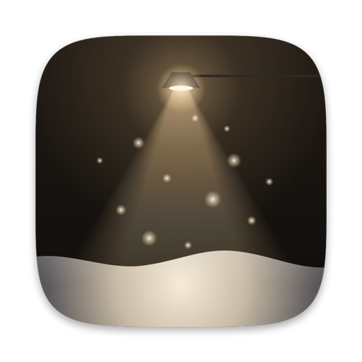

<p align="center">
  
</p>

<h1 align="center">Snowhush</h1>

<p align="center">It's snowing on your desktop.</p>

<p align="center">
  <a href="https://github.com/mbezruchko/Snowhush/releases/latest/download/Snowhush.dmg"><b>Download for macOS</b></a>
  &nbsp;·&nbsp;
  <a href="https://snowhush.pages.dev">snowhush.pages.dev</a>
  <br>
  <sub>macOS 14 or later · free and open source</sub>
</p>

https://github.com/user-attachments/assets/d220b1e3-4e87-447f-a934-6ca054defc57

A tiny menu bar app. Soft snow drifts across your screen, settles along the tops of your windows and slips off when you drag them. Sweep the drift aside with your cursor.

## What the snow does

- **Falls.** Every flake keeps its own pace and sways in a slow breeze. Variable lets the snowfall rise and ease on its own over the day.
- **Settles.** It piles up and slumps to a natural slope along the bottom of the screen, on any window with room above it, and on the Dock.
- **Moves.** Push the cursor through a drift and it parts and sprays. Drag or shake a window and its snow slides off and lands below.
- **Drops.** Close or minimize a window and its snow drops at once, in lumps that burst into powder where they land.
- **Melts.** With Melt Snow on, the drift thaws slowly, so it never takes over your screen.
- **Hides.** Screenshots and screen sharing show your desktop without it, unless you turn on Show in Screenshots.
- **Rests.** About 6% of one processor core and 65 MB of memory, and less on battery or in Low Power Mode. It pauses while your screen sleeps, locks or is covered.

Everything else lives in the menu bar: Snowfall (Off, Light, Steady, Heavy, Variable), Accumulate, Melt Snow, Snow on Windows, Behind Windows, Show in Screenshots and Open at Login.

## Building

```sh
./build.sh            # build/Snowhush.app, signed ad hoc
open build/Snowhush.app
```

## Releasing

```sh
./release.sh 0.2.0 "What changed"
```

Bumps the version, signs with Developer ID, notarizes, and publishes `Snowhush.dmg` and `appcast.xml` as a GitHub release. The app checks the appcast of the latest release with Sparkle.

One-time setup on the release machine:

- a "Developer ID Application" certificate in the keychain;
- a notarytool profile: `xcrun notarytool store-credentials snowhush --apple-id <apple-id> --team-id <team-id>`;
- the Sparkle EdDSA private key in the login keychain (`.build/sparkle-tools/bin/generate_keys`); its public key is `SUPublicEDKey` in `Resources/Info.plist`.

## Site

`site/` is a static page served by Cloudflare Pages at [snowhush.pages.dev](https://snowhush.pages.dev): no build command, output directory `site`. Every push to `main` deploys it.

## License

[MIT](LICENSE)
